<h3>
<samp>hey, i'm eddie 👋</samp>
</h3>

  

  <samp>ml research intern @ uic · incoming swe intern @ abbvie</samp>

<samp>

- ml research intern @ uic, working on computer vision
- joining abbvie's business technology solutions team in summer 2027 as a swe intern
- first-gen cs student building tools for chicago's latino and first-gen community
- board member at logica, member of shpe and colorstack
- outside code, i fish and play games
</samp>

<h4><samp>projects</samp></h4>

<samp>

| | |
| [corazón](https://github.com/edug-0/Corazon) | bilingual resource platform for latino communities, built at wildhacks 2026. i led the ai/ml side: five randomforest models and a llama 3.3 chatbot that answers from a database of local resources. |
| [into the unknown](https://github.com/edug-0/IntoTheUnknown) | nasa space apps 2026 web app (team logica) that plays spherex telescope images of any sky patch as a flipbook, so moving stars stand out. i led the frontend: orrery home, sky view, guided tour |

</samp>

  

  <samp><a href="https://linkedin.com/in/eduardogalvan0">linkedin</a></samp>

